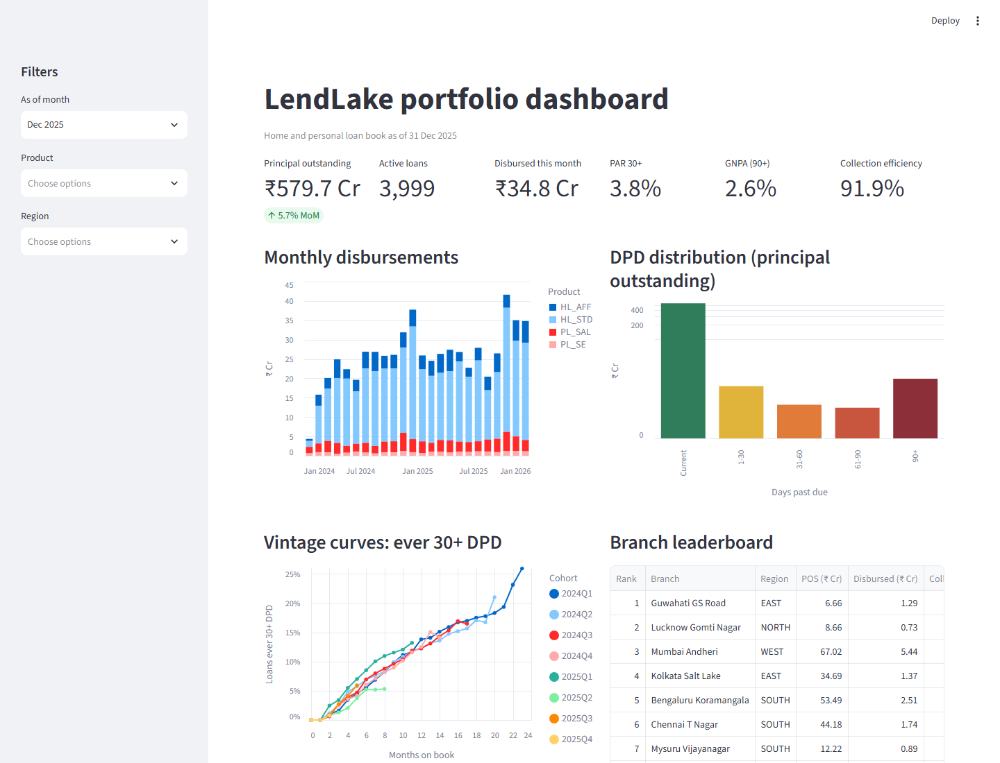

# LendLake

A lending analytics lakehouse for a retail home loan and personal loan book. It runs on DuckDB and dbt with a medallion layout, and every run is driven by an explicit run date.

[](https://github.com/Raja9964/LendLake/actions/workflows/ci.yml)



## Why

Portfolio reporting for a loan book raises a few hard problems. Source extracts are messy and arrive late. Month-end numbers have to be reproducible. A metric like collection efficiency is easy to double count. LendLake works through each of these end to end, on synthetic data, with tests that would catch a regression.

## Features

- **Synthetic source systems.** A seeded numpy simulation of a lending book that you can scale up or down. It covers branches, customers, applications, sanctions, disbursements, EMI schedules, repayments (on-time, late, bounced, partial) and collections activity. It writes monthly batches as CSV, JSON and JSON Lines.
- **Realistic data problems.** The extracts contain duplicates, blanks, inconsistent casing and whitespace, and city aliases (Bangalore/Bengaluru). Dates come in four formats and some amounts use Indian digit grouping (`12,50,000.00`). Collections timestamps mix UTC and IST. Some records arrive a batch late, and the repayments extract gains a new column mid-2024.
- **Bronze.** Idempotent ingestion into DuckDB's `raw` schema, with `_batch_id`, `_source_file` and `_ingested_at` on every row. Each file is checksummed and logged. Re-running a batch does nothing, and a changed file replaces its own rows.
- **Silver.** dbt models that clean, type, de-duplicate and conform the data. PAN is hashed and phone numbers are normalised. One dbt snapshot keeps SCD2 history of customer attributes.
- **Gold.** Dimensions and facts, a loan-level month-end portfolio snapshot (outstanding principal and DPD), plus marts for delinquency buckets, collection efficiency, vintage curves and branch performance. The facts and the snapshot are incremental.
- **Run-date driven.** `--run-date` is passed to dbt as a var. No model reads `current_date`, so any month can be re-run or backfilled.
- **Data quality.** About 130 dbt tests per build, a mix of built-in, `dbt_utils` and custom generic and singular tests.
- **Orchestration.** A small Python CLI that runs generate, ingest and `dbt build` month by month.
- **Dashboard.** A Streamlit app on port 8105 with KPI tiles, a disbursement trend, the DPD distribution, vintage curves and a branch leaderboard.
- **CI.** GitHub Actions runs lint, generation, a 12-month pipeline, `dbt build` and pytest.

## Architecture

```mermaid
flowchart LR
    subgraph Sources["Synthetic source extracts (monthly batches)"]
        S1[branches.json]
        S2[customers / applications / sanctions / disbursements .csv]
        S3[emi_schedule / repayments .csv]
        S4[collection_activities.jsonl]
    end
    subgraph Bronze["Bronze: DuckDB raw schema"]
        B[raw.* all-varchar tables<br/>+ _batch_id, _source_file, _ingested_at<br/>+ raw._ingestion_log]
    end
    subgraph Silver["Silver: dbt (schema silver)"]
        SV[stg_* typed, cleaned, de-duplicated]
        SN[snap_customers SCD2 snapshot]
    end
    subgraph Gold["Gold: dbt (schema gold)"]
        D[dim_date / dim_branch / dim_customer / dim_product]
        F[fct_disbursement / fct_repayment / fct_portfolio_snapshot]
        M[mart_* delinquency, collections, vintage, branch, summary]
    end
    Sources -->|lendlake ingest| Bronze --> SV --> SN --> D
    SV --> F --> M
    D --> F
    M --> DB[Streamlit dashboard :8105]
```



The CLI processes one month at a time: generate batch, then `ingest_batch` into bronze, then `dbt build --vars '{run_date: <month end>}'`.

## Data model and lineage

| Model | Layer | Grain | Materialization |
|---|---|---|---|
| `dim_date` | Gold | one row per calendar day (2020-2050), with Indian fiscal year | table |
| `dim_branch` | Gold | one row per branch | table |
| `dim_product` | Gold | one row per product (from seed) | table |
| `dim_customer` | Gold | one row per customer version (SCD2, from `snap_customers`) | table |
| `fct_disbursement` | Gold | one row per disbursement (= loan; single tranche) | incremental, delete+insert on `disbursement_id` |
| `fct_repayment` | Gold | one row per payment attempt, bounces included | incremental, delete+insert on `payment_id` |
| `fct_portfolio_snapshot` | Gold | one row per loan per month end while open | incremental, month partitions replaced |
| `mart_delinquency_buckets` | Gold | month x branch x product x DPD bucket (zero-filled) | table |
| `mart_collection_efficiency` | Gold | month x branch x product | table |
| `mart_vintage_analysis` | Gold | disbursement cohort x product x months on book | table |
| `mart_portfolio_summary` | Gold | month x region x product | table |
| `mart_branch_performance` | Gold | month x branch, with ranks | table |

Silver has one `stg_*` model per source table. Two intermediate models sit between Silver and Gold. `int_repayment_allocation` splits payments into interest, principal and penalty. `int_installment_status` records when each installment was fully paid.

The DPD buckets are Current, 1-30, 31-60, 61-90 and 90+. DPD is measured from the oldest installment that was not fully paid by the month end. Collection efficiency counts each payment exactly once. A payment counts against its own month's demand if it was made by that month end. Otherwise it counts as arrears collected in the month it was paid. Every ratio uses `NULLIF` on the denominator.

## Data quality approach

- **Bronze** keeps everything as text. Nothing is rejected at load. Row counts are checked against the batch manifest, and a batch with no `_manifest.json` is treated as incomplete.
- **Silver tests:** `unique` and `not_null` on keys, `relationships` between applications, customers, branches and products, and `accepted_values` on every normalised enum. Ranges are checked with `dbt_utils.accepted_range`.
- **Gold tests:** grain uniqueness via `dbt_utils.unique_combination_of_columns`, foreign keys to the dimensions, and collection efficiency bounded to 0-1.
- **Custom generic tests:** `not_negative` (outstanding, overdue, DPD), `is_month_end` (snapshot dates), and `dpd_bucket_consistent`, which checks that the SQL bucket logic agrees with the `dpd_buckets` seed.
- **Singular tests:**
  - repayments never exceed the EMI plus the late fee and bounce charges;
  - each schedule's principal reconciles to the disbursed amount;
  - mart totals tie to the loan-level snapshot (this catches join fan-out);
  - no gaps in a loan's monthly snapshots.

## Project structure

```
lendlake/            Python package: CLI, config, bronze ingestion, dbt runner
  generator/         seeded simulation, source noise, batch writer
transform/           dbt project (models/silver, models/gold, snapshots, seeds, macros, tests)
dashboard/app.py     Streamlit dashboard
tests/               pytest: generator, bronze idempotency, CLI
.github/workflows/   CI
```

## Quick start

Requires Python 3.12.

```bash
python -m venv .venv
# Windows (PowerShell): .venv\Scripts\Activate.ps1
# macOS/Linux:          source .venv/bin/activate
pip install -r requirements.txt -r requirements-dev.txt

# Generate, ingest and build 24 months of history (2024-01 .. 2025-12)
python -m lendlake run --backfill-from 2024-01-31 --run-date 2025-12-31

# Next month only (the previous month must already be ingested)
python -m lendlake run --run-date 2026-01-31

# Dashboard on http://localhost:8105 (stop it before running the pipeline; DuckDB allows one writer)
python -m lendlake dashboard
```

Individual steps:

```bash
python -m lendlake generate --backfill-from 2024-01-31 --run-date 2024-06-30 --scale 0.2
python -m lendlake ingest   --backfill-from 2024-01-31 --run-date 2024-06-30
python -m lendlake build    --run-date 2024-06-30

# or call dbt directly from the repository root
dbt build --project-dir transform --profiles-dir transform --vars "{run_date: '2024-06-30'}"
```

## Configuration

All settings come from environment variables, optionally set in a `.env` file (see `.env.example`).

| Variable | Default | Meaning |
|---|---|---|
| `LENDLAKE_DATA_DIR` | `data` | landing zone root (`data/landing/<YYYY-MM>/`) |
| `LENDLAKE_DUCKDB_PATH` | `warehouse/lendlake.duckdb` | warehouse file |
| `LENDLAKE_SEED` | `42` | generator seed |
| `LENDLAKE_SCALE` | `1.0` | volume multiplier (about 400 applications a month at 1.0) |
| `LENDLAKE_START_MONTH` | `2024-01` | first month of simulated history |

The dbt vars in `transform/dbt_project.yml` are:

- `lookback_months` sets the restatement window;
- `late_fee_rate` and `bounce_charge` define the penalty policy (a pytest test keeps these in sync with the generator);
- `paid_tolerance` is the rupee tolerance for treating an installment as fully paid.

`transform/profiles.example.yml` documents a BigQuery target. The date parsing and JSON macros already dispatch per adapter, but that target has not been run.

## Testing

```bash
ruff check .
pytest                                   # generator, bronze idempotency, CLI orchestration
dbt build --project-dir transform --profiles-dir transform --vars "{run_date: '2024-12-31'}"
```

## Design decisions

- **The run date is a dbt var, never `current_date`.** Windows are built with `date_trunc` and `last_day`, so any month can be rebuilt the same way.
- **The month snapshot replaces whole partitions.** `delete+insert` keyed on `snapshot_month` rebuilds the run month plus a one-month lookback. Late payments then restate the previous month instead of being appended twice.
- **The repayment fact loads by arrival batch, not payment date.** That way a late-arriving payment is never skipped.
- **Bronze is schema-on-read.** Everything lands as text, and JSON is kept as a payload column. Typing happens in Silver, where the failures can be tested.
- **Idempotency comes from file checksums and replace-by-source-file.** There is no "already loaded" flag for a person to reset by hand.
- **SCD2 lives only in the customer dimension.** Facts pick the customer version valid on the disbursement date (a point-in-time join).
- **Marts keep measures additive** (sums and counts). Ratios are computed after aggregation, so filters in the dashboard never average averages.

## License

MIT. See [LICENSE](LICENSE).
